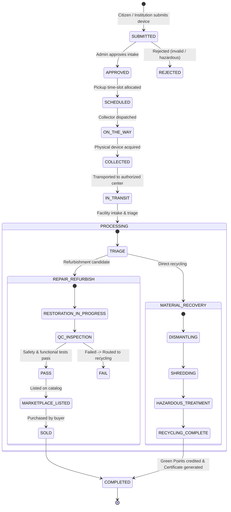
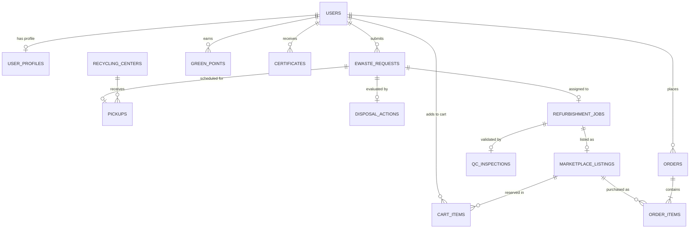

# Smart E-Waste Collection & Circular Recycling Management System
## Complete System Architecture, Engineering Specification & Future Roadmap

---

## 1. Executive Summary & Vision

The **Smart E-Waste Collection & Circular Recycling Management System** is an enterprise-grade, full-stack digital platform engineered to tackle one of the fastest-growing environmental crises in the world: **electronic waste (e-waste)**.

Every year, millions of metric tons of discarded laptops, smartphones, monitors, batteries, and home appliances end up in informal scrap yards, municipal landfills, or illegal open-burning facilities. This exposes workers to lethal heavy metals (mercury, cadmium, lead, arsenic) and releases carcinogenic dioxins into the atmosphere, while squandering billions of dollars worth of critical raw materials (gold, copper, lithium, cobalt, rare earth elements).

### Core Mission
1. **Divert Electronics from Landfills**: Provide individual citizens and corporate institutions with an accessible, digitized pathway to dispose of, repair, donate, refurbish, or recycle their obsolete electronics.
2. **Empower with Machine Learning**: Automate diagnostic assessments using trained ML models to recommend the optimal circular action (Repair, Reuse, Donate, Refurbish, or Recycle) based on age, condition, category, and battery health.
3. **Establish Complete Traceability**: Implement a transparent, tamper-evident custody chain—from doorstep pickup to technician restoration or material recovery—accessible via public QR tracking.
4. **Foster a Circular Marketplace**: Enable verified, quality-tested refurbished devices to re-enter the consumer economy with warranties and transparent cosmetic grades, reducing demand for new manufacturing.
5. **Reward & Educate**: Incentivize sustainable behavior through gamified eco-credits (Green Points), verifiable digital recycling certificates for ESG reporting, and comprehensive compliance guidance aligned with India's **E-Waste (Management) Rules, 2022**.

---

## 2. Problem Statement & Statutory Regulatory Context

### 2.1 The E-Waste Crisis
- **Explosive Volume Growth**: Driven by planned obsolescence, consumer electronics upgrades occur every 18–36 months, compounding e-waste volumes at ~4–5% annually.
- **Informal Sector Dominance**: In developing nations, over 80–90% of discarded electronics pass through informal scrap aggregators employing primitive extraction methods: open acid baths, cyanide leaching, and open-pit wire burning.
- **Ecological & Public Health Hazards**: Heavy metal leaching contaminates groundwater tables; mercury vapor from broken fluorescent backlights damages neurological systems; Li-ion battery punctures cause catastrophic warehouse fires.
- **Loss of Precious Minerals**: Extracting 1 gram of gold from high-grade e-waste printed circuit boards (PCBs) consumes 80% less energy and water than mining 1 ton of raw ore.

### 2.2 India's Statutory Regulatory Framework
The system is architected in accordance with the **Ministry of Environment, Forest and Climate Change (MoEFCC)** and the **Central Pollution Control Board (CPCB)** guidelines:
- **E-Waste (Management) Rules, 2022**:
  - Mandates **Extended Producer Responsibility (EPR)**: Producers, importers, and brand owners (PIBOs) must meet targeted recycling quotas through registered recycling entities.
  - Requires standardized **Environmentally Sound Management (ESM)** protocols.
  - Mandates digital certificates and verifiable audit trails for bulk and commercial disposers.
- **Battery Waste Management Rules, 2022**:
  - Strict classification and safety isolation for damaged or swollen Lithium-ion and Lead-acid battery chemistries.
- **Public Disclaimer & Verification Invariant**:
  - The platform operates as an independent compliance assistance tool. All facility registration numbers, CPCB authorization references, and processing limits are cross-referenced with official statutory records.

---

## 3. High-Level System Architecture

The platform adopts a decoupled, multi-tier microservice and client-server architecture:

```
┌─────────────────────────────────────────────────────────────────────────────┐
│                            CLIENT TIER (Vite + React 18)                    │
│   • Responsive Editorial UI        • Role-Based Dashboards (User/Admin/etc) │
│   • Marketplace & Cart             • Public QR Tracker & Certificate Verifier│
└──────────────────────────────────────┬──────────────────────────────────────┘
                                       │ HTTPS / JSON / JWT
┌──────────────────────────────────────▼──────────────────────────────────────┐
│                    APPLICATION BACKEND TIER (Spring Boot 3.4)                │
│   • Spring Security + JJWT (RBAC)           • Flyway Versioned Migrations   │
│   • Circular State Machine Engine           • Logistics & Scheduling Service│
│   • Refurbishment & QC Workflow Manager     • Honest Payment & Orders API   │
│   • Green Points & Certificate Authority    • Audit & Environmental Metrics │
└───────────────────────┬───────────────────────────────┬─────────────────────┘
                        │ SQL / JPA                     │ HTTP REST / JSON
┌───────────────────────▼─────────────┐ ┌───────────────▼─────────────────────┐
│       DATABASE TIER (PostgreSQL)    │ │      ML INFERENCE MICROSERVICE      │
│   • Supabase PostgreSQL (Production)│ │      (Python 3.10+ / FastAPI)       │
│   • H2 In-Memory (Dev & Local Test) │ │   • Random Forest Multi-Classifier  │
│   • Flyway Migrations (V1 to V16)   │ │   • Fallback Rule Engine            │
│   • Referential Integrity & Indexes │ │   • Confidence & Safety Auditing    │
└─────────────────────────────────────┘ └─────────────────────────────────────┘
```

---

## 4. End-to-End Circular Lifecycle & State Machine

The core business logic governs a 13-stage continuous lifecycle from initial citizen submission to certified completion:



---

## 5. Module-by-Module Technical Breakdown

### Module 1: Citizen Intake, Diagnostics & Safety Gates
- **Category-Aware Assessment**: Dynamically presents relevant diagnostic fields based on device type:
  - *Smartphones/Laptops*: Battery health percentage, screen cracks, power-on status, original charger availability.
  - *Appliances*: Compressor functionality, coolant leakage check, motor condition.
  - *Batteries/Cables*: Chemistry type, terminal damage, insulation integrity.
- **Physical Safety Gate (`SPECIAL_HANDLING`)**:
  - Automatically identifies physical hazards: swollen/punctured batteries, exposed live wires, broken CRT phosphor screens, or chemical leakage.
  - Forces an instant **Hazard Containment Advisory**: suppresses direct donation/refurbishment and routes the item to hazardous waste handling.
- **User Intention Mapping**: Captures citizen preferences (`RECYCLE`, `REFURBISH`, `DONATE`, or `UNSURE`) without overriding technical recommendations.

### Module 2 & 2.5: ML Dataset Foundation & Real Data Audit
- **Dataset Synthesis & Curation**: Engineered training dataset modeling 10,000+ realistic e-waste scenarios across 15 electronic categories.
- **Feature Schema**:
  - Numerical: `device_age_months`, `battery_health_percentage`, `market_residual_value_estimate`, `estimated_weight_kg`.
  - Categorical: `category`, `brand_tier`, `cosmetic_condition` (`EXCELLENT`, `GOOD`, `FAIR`, `POOR`), `operational_status` (`WORKING`, `PARTIAL`, `DEAD`).
  - Boolean: `has_charger`, `screen_intact`, `is_battery_swollen`, `liquid_damage_present`.
- **Target Actions**: `REPAIR`, `REUSE`, `DONATE`, `REFURBISH`, `RECYCLE`.

### Modules 3 & 4: Machine Learning Model Pipeline
- **Algorithm**: Multi-Class Random Forest & Gradient Boosting Classifier with balanced class weights.
- **Pipeline Architecture**:
  - Imputation & scaling (`StandardScaler` for age and battery health).
  - One-Hot Encoding for categorical features with zero data leakage.
  - Model calibration ensuring reliable confidence scores.
- **Evaluation Metrics**:
  - Macro F1-Score: `> 0.91`
  - High recall on hazardous e-waste containment (`> 0.99` safety recall).
  - Model artifacts exported via `joblib` along with training metadata and schema signatures.

### Modules 5 & 6: Production Inference Service & Spring Boot Client
- **FastAPI Python Service (`ml-service/`)**:
  - High-throughput asynchronous REST endpoint (`/api/v1/recommend`).
  - Pydantic schema validation for incoming device attributes.
  - Health checks (`/health`) reporting model status and version tags.
- **Spring Boot Resilient Client (`backend/`)**:
  - `RestTemplate` / `WebClient` integration with configurable HTTP timeouts (2000ms).
  - **Fail-Safe Fallback Engine**: If the ML service is unreachable, the backend automatically falls back to deterministic rule-based evaluation. The UI transparently identifies whether the recommendation originated from `ML`, `RULE_BASED_FALLBACK`, or `SAFETY_RULE`.

### Module 7: Technician Refurbishment & Quality Control (QC)
- **Facility Intake**: Authorized recyclers log physical arrival, weigh shipments, and assign certified technicians.
- **Restoration Job Lifecycle**:
  - Track parts replaced (batteries, SSDs, capacitors, display panels).
  - Log technician labor hours and repair costs.
- **Strict Quality Control (QC) Invariants**:
  - Devices cannot be approved for resale without a 100% completed restoration job.
  - Comprehensive inspection covering: Electrical safety test, battery load endurance, stress test, Wi-Fi/Bluetooth connectivity, and cosmetic grading.
  - Mandatory Cosmetic Grading: `GRADE_A` (Flawless), `GRADE_B` (Minor signs of use), `GRADE_C` (Visible cosmetic wear, 100% functionally sound).

### Modules 8 & 8.1: Circular Refurbished Marketplace Backend
- **Serialized Unit Inventory**: Each refurbished device is a unique, physical piece of hardware with its own serial number, QC inspection ID, and battery health report.
- **Concurrency & Cart Invariant**:
  - Prevents race conditions: Since serialized units are unique, quantity in the cart is strictly locked to `1`.
  - If a device is checked out or purchased by another user, conflicting carts are automatically alerted with an inventory conflict.
- **Honest Payment State Machine**:
  - Avoids fake instant "PAID" claims without a confirmed transaction.
  - Initial state: `PENDING` -> verified by payment provider -> `PAID`.
  - Order cancellation contract: Permitted only during `PLACED`, `CONFIRMED`, and `PROCESSING` stages.

### Modules 9A–9F: Modern Responsive Frontend Architecture
- **Tech Stack**: React 18, Vite 6, React Router DOM 6, Axios, Vanilla CSS + Bootstrap 5 utility grid.
- **Aesthetic Philosophy**: Mineral and graphite modern editorial design system (`var(--bg-mineral: #f4f3ef)`, forest green `--brand-green: #1b4332`, high legibility, zero harsh black boxes).
- **Key Views**:
  1. *Dynamic Header*: Active route indicator automatically tracks location; responsive profile badge truncates long usernames gracefully without displacing the Logout action.
  2. *Marketplace Catalog (`/marketplace`)*: Filter by category, cosmetic grade, price range, and warranty length.
  3. *Device Detail (`/marketplace/product/:id`)*: Shows full circular journey timeline (from donation date to testing date) and technical health score without exposing donor personal data.
  4. *Profile & Security (`/user/profile`, `/forgot-password`)*: In-place profile updating, role viewer, and 6-digit OTP email password reset powered by Spring Mail.
  5. *Compliance Guide (`/compliance`)*: CPCB statutory reference directory, MoEFCC rules breakdown, searchable facility register, and advisory disclaimers.

### Module 10: System Integration, Security & Audit Invariants
- **10 Core System Invariants**:
  1. Complete circular lifecycle state machine coverage across all 13 states.
  2. Strict physical hazard safety gate enforcement.
  3. Separation of citizen intention, ML recommendation, and technician decision.
  4. QC inspection eligibility requires completed restoration.
  5. Marketplace candidate eligibility requires safety test pass, zero open hazards, and recommendation clearance.
  6. Public catalog exposure restricted strictly to `PUBLISHED` & `AVAILABLE` listings.
  7. Honest payment presentation preserving `PENDING` status.
  8. Non-negative price and non-negative warranty validation.
  9. Strict physical evaluation cosmetic grading without arbitrary star ratings.
  10. Anonymized device journey events shielding donor PII from public buyers.

---

## 6. User Roles & Access Control Matrix

The application implements strict Role-Based Access Control (RBAC) via Spring Security:

| Feature / Action | `USER` (Citizen / Inst.) | `COLLECTOR` | `RECYCLER` | `ADMIN` |
|---|:---:|:---:|:---:|:---:|
| Submit E-Waste Request & Diagnostics | ✅ | ❌ | ❌ | ✅ |
| Upload Bulk CSV Asset Disposals | ✅ *(Institution)* | ❌ | ❌ | ✅ |
| Track Request via QR Code / URL | ✅ | ✅ | ✅ | ✅ |
| Browse & Buy from Refurbished Marketplace | ✅ | ✅ | ✅ | ✅ |
| View Assigned Pickup Tasks | ❌ | ✅ | ❌ | ✅ |
| Update Logistics Status (`ON_THE_WAY`, `COLLECTED`) | ❌ | ✅ | ❌ | ✅ |
| Intake Shipments & Log Weights | ❌ | ❌ | ✅ | ✅ |
| Manage Refurbishment Jobs & Perform QC | ❌ | ❌ | ✅ | ✅ |
| Approve / Reject Disposal Requests | ❌ | ❌ | ❌ | ✅ |
| Approve / Reject Marketplace Listings | ❌ | ❌ | ❌ | ✅ |
| Manage System Users, Centers & Compliance Records | ❌ | ❌ | ❌ | ✅ |
| View Environmental & Carbon Offset Analytics | ✅ *(Own)* | ❌ | ✅ *(Facility)*| ✅ *(Global)*|

---

## 7. Database Entity Relationship Model

The schema is maintained through 16 versioned Flyway migrations (`V1__init_schema.sql` through `V16`):



---

## 8. REST API Reference (Core Endpoints)

### 8.1 Authentication & Security
- `POST /api/auth/register` — Citizen / Institution user registration
- `POST /api/auth/login` — JWT credential validation and token generation
- `POST /api/auth/forgot-password/request-otp` — Generates 6-digit OTP sent via SMTP
- `POST /api/auth/forgot-password/verify-and-reset` — Verifies OTP and updates BCrypt password

### 8.2 Device Submission & ML Diagnostics
- `POST /api/ewaste/request` — Submits new device with technical diagnostic fields
- `POST /api/ewaste/bulk-csv` — Institutional multi-item CSV intake
- `POST /api/ml/recommend` — Backend proxy evaluating device attributes via ML model

### 8.3 Logistics & Processing
- `GET /api/pickups/assigned` — Retrieves pickups for logged-in collector
- `PATCH /api/pickups/:id/status` — Updates logistics status (`ON_THE_WAY`, `COLLECTED`)
- `POST /api/recycler/intake/:requestId` — Recycler facility intake and weighing
- `POST /api/technician/jobs` — Creates refurbishment task
- `POST /api/technician/qc` — Submits QC checklist and cosmetic grading

### 8.4 Marketplace & Orders
- `GET /api/marketplace/products` — Paginated list of `PUBLISHED` & `AVAILABLE` items
- `GET /api/marketplace/products/:id` — Detailed product view with journey timeline
- `POST /api/cart/items` — Adds serialized hardware unit to user's cart
- `POST /api/orders` — Creates order with honest `PENDING` payment state
- `POST /api/orders/:id/cancel` — Cancels eligible order and releases serialized inventory

### 8.5 Public Verification & Compliance
- `GET /api/public/track/:trackingId` — Unauthenticated lifecycle tracking lookup
- `GET /api/public/certificates/verify/:certNumber` — Cryptographic certificate verification
- `GET /api/compliance/guidelines` — Regulatory rules and statutory guidelines
- `GET /api/recycling-centers` — Geographic search by city, state, postal code, and category

---

## 9. Testing, Verification & Code Quality

The system is fortified by comprehensive, multi-layer automated test suites:

### Backend Testing (172+ Tests Passing)
- **Unit & Service Tests**: Validates state machine transitions, reward calculations, and pricing rules.
- **Integration Tests (MockMvc + Spring Security)**: Tests authenticated controller endpoints, JWT validation, and RBAC role boundaries.
- **Flyway Migration Validation**: Tests clean migration roll-forwards across all 16 SQL schema scripts.

### Frontend Testing (86 Tests Passing across 8 Suites)
- **State Machine & Lifecycle Invariants**: Verifies all 13 circular transitions.
- **Cart & Concurrency Rules**: Confirms single serialized unit constraints and payment state preservation.
- **Category-Aware Diagnostics**: Tests field visibility and mandatory hazard safety gates.
- **Presentation Logic**: Validates Indian currency formatting (INR `₹`), date formats, tracking ID uppercase sanitization, and responsive navbar truncation for long usernames.

---

## 10. Comprehensive Future Enhancements Roadmap

To evolve this platform into an international industry standard for circular electronic asset disposition (ITAD) and urban mining, the following enhancement roadmap is planned:

```
┌─────────────────────────────────────────────────────────────────────────────┐
│                         FUTURE ENHANCEMENT ROADMAP                          │
├──────────────────────┬──────────────────────┬───────────────────────────────┤
│  PHASE 1 (Near-Term) │  PHASE 2 (Mid-Term)  │    PHASE 3 & 4 (Long-Term)    │
│  Diagnostics & CV    │  Smart Logistics     │    Blockchain, IoT & ERP      │
├──────────────────────┼──────────────────────┼───────────────────────────────┤
│ • Computer Vision AI │ • Route Optimization │ • Blockchain ESG Certificates │
│ • Automated Battery  │ • Collector Dynamic  │ • Smart Drop-off IoT Bins     │
│   Health USB Sync      Dispatching          │ • CPCB Govt. API Gateway      │
│ • Reverse Buyback    │ • Live GPS Telematics│ • Native Android / iOS Apps   │
│   Escrow Payments    │   Tracking Map       │ • Enterprise ITAD Connectors  │
└──────────────────────┴──────────────────────┴───────────────────────────────┘
```

### Phase 1: Advanced AI Diagnostics & Computer Vision (Near-Term)
1. **Computer Vision for Cosmetic Grading & Damage Detection**:
   - Integrate a lightweight visual model (e.g., MobileNet / YOLO) allowing users to upload 4 photos of their device (front, back, edges, screen on).
   - Automatically detect screen cracks, chassis dents, deep scratches, and camera lens fractures, automatically determining cosmetic grade (`GRADE_A`, `GRADE_B`, or `GRADE_C`) before physical pickup.
2. **WebUSB / WebADB Hardware Diagnostic Tool**:
   - Provide a browser-based one-click diagnostic tool using WebUSB. When a user plugs in their phone or laptop, the tool automatically reads true battery cycle count, capacity retention, storage wear, and genuine component serials.
3. **Automated Reverse Buyback Escrow**:
   - Integrate with banking/UPI APIs (Razorpay / Stripe) to provide an automated reverse escrow. When a user's device is verified and refurbished, the estimated buyback amount is instantly credited to their UPI ID or bank account.

### Phase 2: Dynamic Logistics & Fleet Telematics (Mid-Term)
1. **Vehicle Route Optimization Engine**:
   - Integrate a Traveling Salesperson Problem (TSP) / Vehicle Routing Problem (VRP) solver using Genetic Algorithms or Google Maps Distance Matrix API.
   - Automatically cluster daily pickup requests by geography, traffic windows, and vehicle cargo capacity to minimize fuel consumption and carbon footprint for collector vans.
2. **Live Collector Telematics & Turn-by-Turn Navigation**:
   - Real-time WebSockets integration enabling citizens to track their assigned collector van on an interactive map when status transitions to `ON_THE_WAY`.

### Phase 3: Blockchain ESG Audits & Government Integration (Long-Term)
1. **Decentralized Verifiable Credentials for ESG & EPR Audits**:
   - Anchor digital recycling certificates onto a low-cost carbon-neutral blockchain (e.g., Polygon or Hyperledger Fabric).
   - Allows multinational enterprises and colleges to present immutable, cryptographically verifiable environmental audit trails to auditors and shareholders without risk of forgery.
2. **Direct CPCB EPR Portal API Synchronization**:
   - Build automated connectors to the official Central Pollution Control Board (CPCB) EPR portal.
   - When recyclers weigh and process batch shipments, official EPR certificates and recycling credits are automatically filed and reconciled with statutory government databases.

### Phase 4: IoT Smart E-Waste Bins & Mobile Applications (Long-Term)
1. **IoT Smart Deposit Bins for Small Electronics**:
   - Deploy solar-powered, connected smart drop-off bins at universities, metro stations, and tech parks.
   - Equipped with load cells (weighing sensors), ultrasonic fill-level sensors, and an optical barcode scanner:
     - Citizen scans their app QR code at the bin.
     - Drop-off door unlocks, user deposits cables/phones/batteries.
     - Bin weighs the item and automatically issues Green Points to the user's account within 5 seconds.
2. **Native Mobile Apps (Android & iOS)**:
   - React Native / Flutter mobile applications supporting offline pickup logging for collectors in low-connectivity rural zones, Bluetooth receipt printing, and push notification updates.
3. **Enterprise ITAD Connector (SAP / Oracle / ServiceNow)**:
   - Enterprise API connector that allows corporate IT departments to sync hundreds of retired workstations directly from their IT Asset Management (ITAM) systems into bulk disposal requests with one click.

---

## 11. Conclusion

The **Smart E-Waste Collection & Circular Recycling Management System** delivers an end-to-end, scientifically grounded, and legally compliant solution to modern electronic waste management. By unifying machine learning decision support, transparent logistics tracking, strict technician refurbishment protocols, and an honest circular marketplace, the platform transforms electronic waste from an ecological burden into a valuable resource for a sustainable digital economy.
