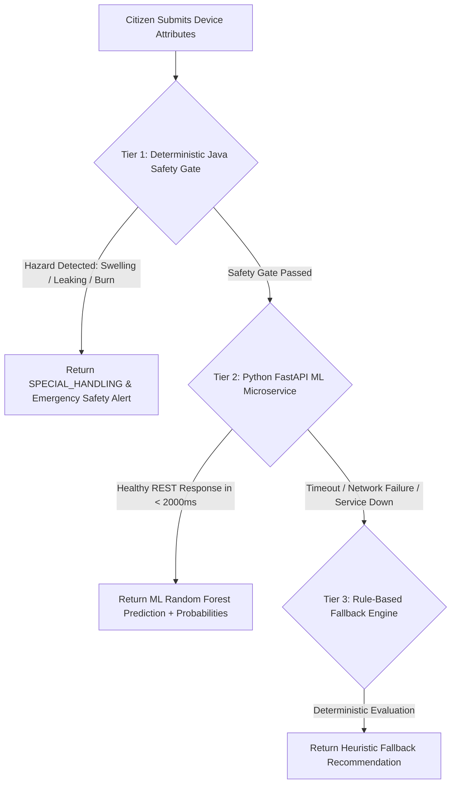
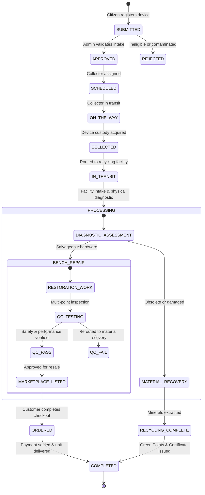

# Smart E-Waste Collection & Circular Recycling Management System
## Comprehensive System Engineering Specification, Technical Architecture & Faculty Defense Guide

---

## 1. Executive Summary & Problem Formulation

### 1.1 Project Title & Domain
* **Project Title:** Smart E-Waste Collection & Circular Recycling Management System
* **Domain:** Circular Economy, Sustainable Computing, Environmental Software Engineering, Applied Machine Learning, Enterprise Web Applications
* **Target Audience:** Individual Citizens, Commercial & Educational Institutions, Logistics Field Collectors, Certified Recycling & Refurbishment Facilities, Statutory Auditors (CPCB/SPCB), and System Administrators.

### 1.2 The Real-World Problem
Electronic waste (e-waste) is the fastest-growing domestic waste stream on Earth, compounding at **4–5% annually**. 
* **Toxicity:** E-waste comprises heavy metals (lead, cadmium, mercury, hexavalent chromium) and persistent organic pollutants (flame retardants in circuit boards). Primitive disposal in unorganized scrap yards leads to groundwater contamination and carcinogenic atmospheric emissions from open burning.
* **Loss of Strategic Minerals:** Discarded PCBs contain concentrations of gold, silver, copper, and rare earth elements up to **40–50 times higher** than raw natural ores.
* **Lack of Formalized Circularity:** Over 85% of electronics are disposed of without formal assessment, preventing salvageable devices from being refurbished, repaired, or redistributed.

### 1.3 Project Objectives
1. **Intelligent Intake & ML Decision Support:** Leverage a Multi-Class Machine Learning model combined with a deterministic safety gate to automatically recommend optimal circular paths (*Repair, Reuse, Donate, Refurbish, Recycle*).
2. **End-to-End Chain-of-Custody:** Establish an unbroken 13-stage custody pipeline from citizen doorstep collection to certified material recovery or refurbished marketplace resale.
3. **Hardware Provenance & Public QR Verification:** Provide tamper-evident, anonymized circular tracking for every device without exposing donor personally identifiable information (PII).
4. **Refurbished Marketplace with Concurrency Safety:** Build an e-commerce platform for unique serialized units with atomic locking to prevent race conditions.
5. **Integrated Payment Gateway:** Integrate Razorpay with HMAC-SHA256 cryptographic verification and a zero-configuration sandbox simulator.
6. **Regulatory Compliance:** Implement digital audit trails aligned with India's **E-Waste (Management) Rules, 2022** and **Battery Waste Management Rules, 2022**.

---

## 2. High-Level System Architecture

The project employs a decoupled **3-Tier Distributed Microservices Architecture**:

```
┌─────────────────────────────────────────────────────────────────────────────┐
│                       1. PRESENTATION TIER (Single-Page App)                │
│   • Technology: React 18 + Vite 6 + React Router 6 + Axios + Bootstrap Grid │
│   • Aesthetics: Mineral & Forest Green Editorial Design System              │
│   • Role Consoles: Citizen Portal, Collector Dashboard, Recycler Benches,   │
│     Admin Console, Public Marketplace, Order Tracking, QR Cert Verifier     │
└──────────────────────────────────────┬──────────────────────────────────────┘
                                       │ HTTPS / REST / JSON (Stateless JWT)
┌──────────────────────────────────────▼──────────────────────────────────────┐
│                    2. APPLICATION BACKEND TIER (Spring Boot 3.4)             │
│   • Technology: Java 17, Spring Boot 3.4, Spring Security, Hibernate/JPA   │
│   • Core Modules:                                                           │
│     - Security Filter Chain: Stateless JWT authentication & RBAC            │
│     - State Machine Engine: 13-stage circular custody lifecycle             │
│     - 3-Tier Hybrid Engine: Safety Gate -> ML Client -> Fallback Rule Engine│
│     - Technician Benches: Diagnostic Intake, Restoration Jobs & Multi-Pt QC │
│     - Refurbished Marketplace: Serialized unit inventory & Cart checkout    │
│     - Payment Gateway: Razorpay initiation & HMAC-SHA256 signature verifier │
│     - ESG Authority: Verifiable PDF/QR Recycling Certificates & Eco-Credits │
└───────────────────────┬───────────────────────────────┬─────────────────────┘
                        │ SQL (Hibernate / JDBC)        │ HTTP REST / JSON
┌───────────────────────▼─────────────┐ ┌───────────────▼─────────────────────┐
│    3A. DATABASE PERSISTENCE TIER    │ │     3B. MACHINE LEARNING ENGINE     │
│   • PostgreSQL (Production/Supabase)│ │   • Python 3.10+ / FastAPI / Uvicorn│
│   • H2 In-Memory (Dev/Testing)      │ │   • Random Forest Multi-Classifier  │
│   • 23 Relational Tables in 3NF     │ │   • Model Versioning & Probabilities│
│   • Flyway Migrations (V1 to V17)   │ │   • Health & Diagnostic Metrics     │
└─────────────────────────────────────┘ └─────────────────────────────────────┘
```

---

## 3. Technology Stack Justification (Why These Technologies?)

| Component | Selected Technology | Technical Justification for Faculty Review |
|---|---|---|
| **Backend Core** | **Java 17 & Spring Boot 3.4** | Enterprise stability, type safety, automatic thread pooling, transactional rollbacks (`@Transactional`), and dependency injection. |
| **Security** | **Spring Security 6 + JJWT** | Stateless session management via signed JSON Web Tokens (HMAC-SHA512). Eliminates server-side session memory consumption and supports horizontal scaling. |
| **Database Migration**| **Flyway Database Migrations** | Deterministic, version-controlled schema evolution (`V1` to `V17`). Eliminates out-of-sync database errors between team environments and production. |
| **Frontend UI** | **React 18 + Vite 6** | Ultra-fast Hot Module Replacement (HMR), Virtual DOM for smooth reactivity, modular component tree, and production bundle minification (< 1.2s build). |
| **API Communication**| **Axios with Interceptors** | Centralized request interceptor automatically attaches the bearer token; response interceptor uniformly formats backend exception payloads. |
| **ML Microservice** | **Python 3 + FastAPI** | Asynchronous ASGI request handling via Starlette/Uvicorn, fast execution, automatic Pydantic request validation, and OpenAPI documentation. |
| **ML Algorithm** | **Random Forest Classifier** | Handles non-linear feature interactions, resistant to overfitting via bootstrap aggregating (bagging), provides class probabilities, and executes inference in < 15ms. |
| **Payment Gateway** | **Razorpay + HMAC-SHA256** | Standard payment gateway for Indian Rupee (INR), supporting UPI, Cards, and NetBanking with server-side cryptographic signature validation. |

---

## 4. Database Architecture & Complete Relational Schema (23 Tables in 3NF)

The database schema is fully normalized up to **Third Normal Form (3NF)** and versioned through **Flyway Migrations (`V1` through `V17`)**:

```
                                  [users]
                                     │ 1:1
                              [user_profiles]
                                     │ 1:N
        ┌────────────────────────────┼────────────────────────────┐
        ▼                            ▼                            ▼
 [disposal_requests]        [reward_transactions]           [marketplace_orders]
        │ 1:N                        │                            │ 1:N
  [ewaste_items]             [notifications]             [marketplace_order_items]
        │ 1:1                                                     │
   [pickups]                                                      │ M:1
        │ 1:1                                                     ▼
[device_assessments] ────────► [restoration_jobs] ────────► [marketplace_listings]
                                     │ 1:1                        │ 1:N
                               [quality_checks]          [marketplace_listing_images]
```

### Table Dictionary Summary

| # | Table Name | Purpose | Primary Key | Key Foreign Keys & Constraints |
|---|---|---|---|---|
| 1 | `users` | Master authentication and RBAC credentials | `id` (BIGINT) | `email` (UNIQUE), `role` (`USER`, `COLLECTOR`, `RECYCLER`, `ADMIN`) |
| 2 | `user_profiles` | Citizen demographic and contact details | `id` (BIGINT) | `user_id` $\rightarrow$ `users(id)` (UNIQUE) |
| 3 | `recycling_centers`| Registered municipal & commercial facilities | `id` (BIGINT) | `license_number` (UNIQUE), coordinates, capacity limits |
| 4 | `recyclers` | Recycler enterprise metadata | `id` (BIGINT) | `user_id` $\rightarrow$ `users(id)`, `center_id` $\rightarrow$ `recycling_centers(id)` |
| 5 | `disposal_requests`| Customer e-waste disposal intake requests | `id` (BIGINT) | `user_id` $\rightarrow$ `users(id)`, `status`, `tracking_id` (UNIQUE) |
| 6 | `ewaste_items` | Individual physical electronic hardware units | `id` (BIGINT) | `request_id` $\rightarrow$ `disposal_requests(id)`, `category`, `condition` |
| 7 | `pickups` | Doorstep logistics transit records | `id` (BIGINT) | `request_id` (UNIQUE), `collector_id` $\rightarrow$ `users(id)`, status |
| 8 | `disposal_status_histories`| Audit log of all lifecycle transitions | `id` (BIGINT) | `request_id` $\rightarrow$ `disposal_requests(id)`, timestamp, actor |
| 9 | `reward_transactions`| Gamified Green Points ledger | `id` (BIGINT) | `user_id` $\rightarrow$ `users(id)`, `points_earned`, `eco_tier` |
| 10| `notifications` | Role-based system alerts and dispatch notes | `id` (BIGINT) | `user_id` $\rightarrow$ `users(id)`, `read_status` |
| 11| `recycling_certificates`| Official tamper-evident ESG certificates | `id` (BIGINT) | `certificate_number` (UNIQUE), `qr_code_hash`, CPCB ref |
| 12| `environmental_factors`| Coefficients for carbon & metal recovery | `id` (BIGINT) | `category` (UNIQUE), `co2_kg_factor`, `gold_recovery_g` |
| 13| `compliance_guidelines`| CPCB statutory rulebook references | `id` (BIGINT) | `rule_code`, `category`, `legal_reference` |
| 14| `bulk_institution_requests`| Corporate & university bulk disposals | `id` (BIGINT) | `user_id` $\rightarrow$ `users(id)`, `csv_data`, `asset_count` |
| 15| `device_assessments`| Technician physical diagnostics at facility | `id` (BIGINT) | `request_id` (UNIQUE), `power_status`, `screen_condition` |
| 16| `restoration_jobs` | Bench repair & refurbishing records | `id` (BIGINT) | `assessment_id` $\rightarrow$ `device_assessments(id)`, parts cost, hours |
| 17| `quality_checks` | Multi-point testing & cosmetic grading | `id` (BIGINT) | `job_id` (UNIQUE), `safety_test_passed`, `result` (`PASS`/`FAIL`) |
| 18| `marketplace_listings`| Refurbished devices offered for resale | `id` (BIGINT) | `quality_check_id` (UNIQUE), `price`, `stock_status` (`AVAILABLE`/`SOLD`) |
| 19| `marketplace_listing_images`| Visual product photos | `id` (BIGINT) | `listing_id` $\rightarrow$ `marketplace_listings(id)` |
| 20| `carts` | User shopping basket | `id` (BIGINT) | `user_id` $\rightarrow$ `users(id)` (UNIQUE) |
| 21| `cart_items` | Devices staged for atomic checkout | `id` (BIGINT) | `cart_id` $\rightarrow$ `carts(id)`, `listing_id` (UNIQUE per cart) |
| 22| `marketplace_orders`| Finalized customer purchases | `id` (BIGINT) | `order_number` (UNIQUE), `user_id`, `payment_status`, `payment_tx_id` |
| 23| `marketplace_order_items`| Serialized units allocated to an order | `id` (BIGINT) | `order_id` $\rightarrow$ `marketplace_orders(id)`, `listing_id` |
| 24| `password_reset_tokens`| 6-digit OTP verification table | `id` (BIGINT) | `email`, `otp_hash`, `expiry_time` |

---

## 5. Machine Learning Architecture & 3-Tier Resilient Decision Engine

### 5.1 The 3-Tier Architecture
To ensure zero system downtime, the recommendation system implements a **3-tier fault-tolerant hierarchy**:



### 5.2 Mathematical Formulation of the Random Forest Classifier
* **Problem Type:** Multi-Class Supervised Classification.
* **Target Classes ($Y$):**
  1. `REPAIR` (Minor fault, high economic recovery potential)
  2. `REUSE` (Working condition, direct transfer)
  3. `DONATE` (Functional computing equipment, educational redistribution)
  4. `REFURBISH` (Cosmetic or minor hardware defect, commercial salvage)
  5. `RECYCLE` (Non-functional, hazardous, obsolete, material recovery)
* **Feature Vector ($X$):**
  $$X = [\text{Category}, \text{AgeYears}, \text{Condition}, \text{BatteryHealthPct}, \text{ScreenDamage}, \text{OriginalChargerAvailable}, \text{UserIntention}]$$
* **Ensemble Voting:** An ensemble of $B = 100$ Decision Trees trained with Bootstrap Aggregation (Bagging). For each tree $t_b$, node splits minimize **Gini Impurity**:
  $$I_G(p) = 1 - \sum_{k=1}^{K} p_k^2$$
  Final prediction probability for class $k$:
  $$P(Y = k \mid X) = \frac{1}{B} \sum_{b=1}^{B} I\left(\hat{y}_b(X) = k\right)$$

---

## 6. End-to-End Circular Lifecycle & State Machine

The complete lifecycle consists of **13 deterministic state transitions**:



---

## 7. Refurbished Marketplace & Payment Gateway Engineering

### 7.1 Concurrency Control & The "SOLD ≠ PAID" Invariant
Refurbished electronic equipment differs from standard retail: **every physical unit is unique and serialized**.
1. **Cart Quantity Invariant:** A user can only purchase a quantity of `1` for any given listing.
2. **Race Condition Protection:** When an order is placed, the backend locks the inventory listing atomically (`stock_status = 'RESERVED'`). If a concurrent user attempts to check out the same unit, the database rejects the transaction with an HTTP `409 Conflict`.
3. **Honest Payment Lifecycle:**
   - Placing an order transitions status to `PLACED` and payment status to `PENDING`.
   - The hardware is reserved, but the order is **never marked `PAID`** until cryptographic proof is verified.

### 7.2 Razorpay Payment Gateway & Cryptographic Verification
* **Payment Initiation:** The backend issues a signed Razorpay Order with the total payable amount converted to **Paisa** (1 INR = 100 Paisa).
* **Cryptographic Verification (HMAC-SHA256):** When the payment completes, Razorpay returns:
  - `razorpay_order_id`
  - `razorpay_payment_id`
  - `razorpay_signature`
* The backend independently computes the HMAC signature:
  $$\text{Expected Signature} = \text{HMAC-SHA256}(\text{razorpay\_order\_id} + "|" + \text{razorpay\_payment\_id}, \text{Secret Key})$$
  Only when `Expected Signature == razorpay_signature` is the order marked `PAID` and `CONFIRMED`.
* **Zero-Setup Dummy Sandbox Mode:** If real API keys are not supplied (e.g., student evaluation without a PAN card), the application automatically opens a **realistic dummy Razorpay modal** with UPI QR, Test Cards, and NetBanking, simulating complete settlement without failing.

---

## 8. Software Design Patterns Implemented in Codebase

| Design Pattern | Where It Is Used | Implementation Code Reference |
|---|---|---|
| **Strategy Pattern** | Recommendation Engine | `HybridRecommendationEngine.java` dynamically delegates to `MLInferenceClient` or `RuleBasedRecommendationEngine`. |
| **State Machine Pattern**| 13-Stage Custody Lifecycle | `DisposalRequestService.java` enforces permissible state transitions and rejects illegal skips. |
| **Data Transfer Object (DTO)**| API Boundary Segregation | `OrderDetailDTO.java`, `CreateOrderDTO.java` prevent exposing JPA entities or internal database schemas. |
| **Repository Pattern**| Database Access | Spring Data JPA interfaces (`MarketplaceOrderRepository`, `EWasteItemRepository`). |
| **Facade Pattern** | Workflow Orchestration | `TechnicianWorkflowService.java` coordinates assessments, restoration jobs, and QC inspections behind a unified interface. |
| **Interceptor Pattern** | Client & Security Filter Chain | `apiClient.js` Axios interceptors for JWT token injection and HTTP error normalization. |

---

## 9. Comprehensive Faculty Viva / Defense Q&A Cheatsheet

### Q1: Why did you choose Random Forest instead of a Deep Neural Network (CNN/RNN)?
> **Answer:** "Our dataset consists of tabular, heterogeneous diagnostic features (category, age, battery health, damage state) rather than raw pixels or time-series audio. For tabular data, tree-based ensemble methods like Random Forest consistently outperform deep neural networks without requiring millions of samples. Furthermore, Random Forest executes inference in less than 15 milliseconds, is resilient to overfitting through feature bagging, and provides interpretable class probabilities."

### Q2: What happens if your Python Machine Learning microservice crashes during production?
> **Answer:** "Our platform incorporates a 3-tier resilient hybrid architecture. If the Python microservice is offline, times out (configurable 2000ms threshold), or returns a network error, the Spring Boot backend automatically falls back to the deterministic Rule-Based Recommendation Engine without crashing. The response honestly informs the user that the advice originated from the rule-based fallback rather than fabricating an AI source."

### Q3: How do you handle race conditions if two customers click 'Buy Now' on the same refurbished laptop simultaneously?
> **Answer:** "Unlike mass-manufactured goods, each refurbished device is a unique serialized hardware unit. When a user initiates checkout, Spring Boot handles the transaction within an isolated `@Transactional` boundary. We verify the unit's stock status. The first transaction atomically transitions the status from `AVAILABLE` to `RESERVED`, locking the record. The second concurrent transaction detects the status change and immediately returns an HTTP 409 Conflict, alerting the second buyer that another customer has reserved the device."

### Q4: How does the payment gateway guarantee that a user cannot fake a successful payment?
> **Answer:** "We use server-side cryptographic HMAC-SHA256 signature verification. When Razorpay processes a payment, it generates a signature using our private secret key. The frontend sends the transaction ID, order ID, and signature to our backend. The backend concatenates the order ID and payment ID, computes the HMAC-SHA256 hash using our secret key, and compares it to the incoming signature. Because the secret key is strictly stored on the server, a client cannot forge a valid signature."

### Q5: How does your system support India's E-Waste (Management) Rules, 2022?
> **Answer:** "Under MoEFCC and CPCB regulations, bulk consumers and recyclers must maintain verified audit trails to prove Extended Producer Responsibility (EPR) quotas. Our platform generates tamper-evident digital recycling certificates with cryptographic hashes and QR codes, logs full chain-of-custody timestamps, computes carbon offset metrics based on material recovery factors, and isolates hazardous battery waste under the Battery Waste Management Rules, 2022."

### Q6: Why did you use Flyway for database management?
> **Answer:** "Flyway enables database version control. All schema changes and demo seeds are stored as sequential SQL migrations (`V1` to `V17`) in source control. When the backend boots, Flyway inspects the `flyway_schema_history` table and applies unapplied scripts in order. This ensures that every team member, evaluator, and deployment server runs an identical database schema."

---

## 10. Future Roadmap & Limitations

1. **Computer Vision for Automated Cosmetic Grading:** Train a MobileNet / YOLO model allowing citizens to upload 4 device photos to automatically detect chassis cracks, screen bleeding, and dents before pickup.
2. **WebUSB Direct Hardware Diagnostics:** Build a browser-based diagnostic tool via WebUSB to directly read battery cycle counts and storage SMART health upon plugging in a phone or laptop.
3. **Vehicle Routing Problem (VRP) Logistics Optimization:** Integrate Google Maps Distance Matrix API with a genetic algorithm to cluster daily pickup requests and minimize collector fuel consumption.
4. **Blockchain ESG Certificates:** Anchor recycling certificate hashes to a carbon-neutral public ledger (e.g., Polygon) to provide tamper-proof environmental audit records for corporate ESG reporting.
5. **Direct CPCB Portal API Integration:** Build automated REST connectors to push EPR recycling credits directly to the national Central Pollution Control Board portal.
